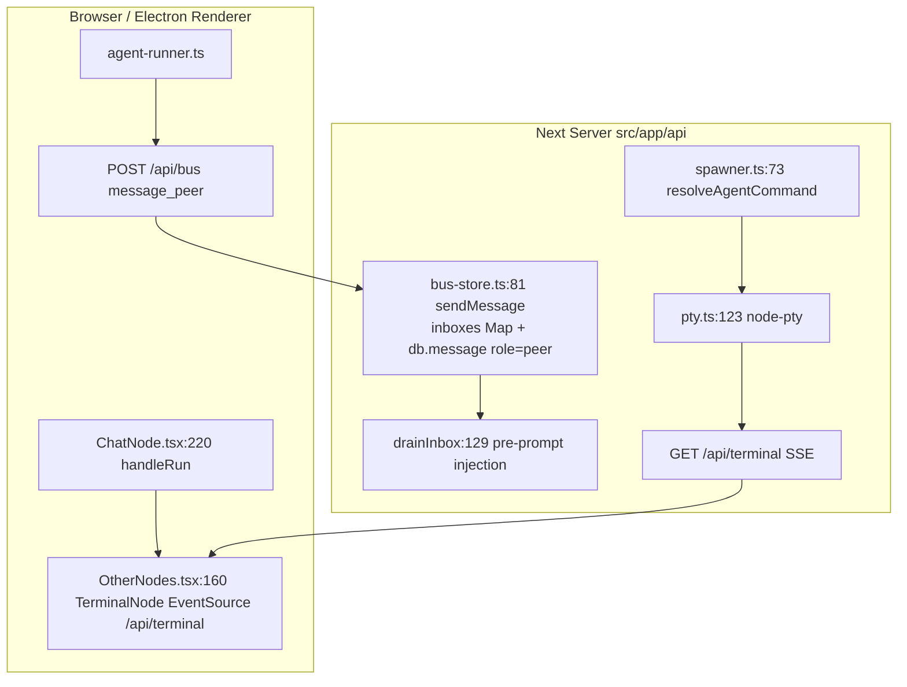
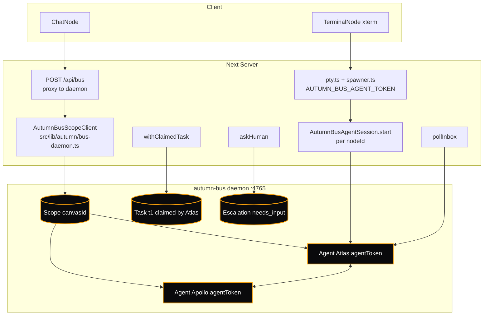

# Autumn Bus — Full-Scale Integration Plan

> **Package:** `@autumn-dev/autumn-bus@0.1.0-next.2` (`node_modules/@autumn-dev/autumn-bus/dist/*`)
> **Daemon:** native `autumn-bus` (`http://127.0.0.1:4765`, `BusRunFile` `protocol.d.ts:128`)
> **Current:** `src/lib/autumn/bus-store.ts:1` Prisma `busPeer` mock (`inboxes Map` + `Message` `role=peer`)
> **Target:** daemon as source of truth, mock as fallback when `AUTUMN_BUS_SCOPE_TOKEN` unset

---

## 1. Why

Current mock handles only `message_peer` + `session/list_peers` via `POST /api/bus` `src/app/api/bus/route.ts:18` `AUTUMN_BUS_TOKEN=autumn-dev-token` `spawner.ts:123`. Full daemon adds `Tasks` with leases, `Human Escalations`, `Heartbeats`, `Inbox reservations`, `MCP`, `Scope isolation` — required for real multi-agent orchestration at scale (the hosted bus is a daemon, not SQLite).

---

## 2. What We Get

| Capability | Mock (`bus-store.ts:44`) | Full Daemon (`dist/client.d.ts:24` / `protocol.d.ts:37`) |
|---|---|---|
| **Messages** | `sendMessage:81` `drainInbox:129` drain-on-read, `queued` only | `sendMessage({to, body, mode:notify|request|response, context: ContextItem[], idempotencyKey})` `protocol.d.ts:111` `DeliveryState queued|reserved|delivered|acknowledged|expired` `reserveInbox/commitInbox/releaseInbox` `pullInbox` + `acknowledgeMessages` + `pollInbox` `session.d.ts:45` bounded backoff |
| **Agents** | `ensurePeer:56` `setPeerStatus:69` `listPeers:145` `PeerStatus live|offline|thinking` | `AutumnBusScopeClient.registerAgent({id, displayName, capabilities, connectTo, leaseMs})` -> `agentToken` `protocol.d.ts:107` `Agent lifecycle starting|ready|working|idle|needs_input|offline` `ready` + `reachable` + `heartbeat(lifecycle,ready,leaseMs)` `session.d.ts:25` `AutumnBusAgentSession.start()` auto heartbeat/replace/shutdown |
| **Tasks** | Separate `Zustand` `store.ts:1694` `tasks` + `prisma Task` table, not bus | `addTask/listTasks/claimTask/releaseTask/completeTask` `client.d.ts:37` `withClaimedTask` `session.d.ts:46` auto-release on fail, `dependencies: TaskId[]` `BusTask:70` `status open|claimed|done` |
| **Human** | `commander` `fallbackPlan` `ask` | `askHuman({question,options})` -> `HumanEscalation pending|resolved` `client.d.ts:42` `listEscalations/resolveEscalation` |
| **Auth** | Single `AUTUMN_BUS_TOKEN` + `inboxes Map` no isolation | `AutumnBusAdminClient.createScope()` -> `scopeToken` per `canvasId` `RegisterAgentResult.agentToken` per `nodeId` `protocol.d.ts:107` |
| **MCP** | stdout parse `[autumn-bus] message_peer → X:` `spawner.ts:10` | `mcpEndpoint(): {url,headers}` `client.d.ts:44` harness calls bus as MCP tool |

---

## 3. Architecture

### Current (Mock)


### Full-Scale (Daemon)


**Hybrid:** `src/lib/autumn/bus-daemon.ts` tries `new AutumnBusClient(addr, token)` if `process.env.AUTUMN_BUS_SCOPE_TOKEN` and `fetch health` succeeds; else fallback to `bus-store.ts` Prisma. `src/app/api/bus/route.ts` becomes thin proxy, zero client changes (`agent-runner.ts` still POSTs `message_peer`).

---

## 4. Integration Plan

### Phase 0 — Daemon Bootstrap (no code, infra)
- Install daemon binary: `npm i -D @autumn-dev/autumn-bus` already `package.json:17`, run `npx autumn-bus daemon --port 4765 --data-dir ./data/bus` -> writes `BusRunFile` `address` `adminToken` `protocol.d.ts:128`
- `AutumnBusAdminClient:6` `new AutumnBusAdminClient(addr, adminToken).createScope({id: canvasId})` -> `scopeToken` -> set `AUTUMN_BUS_SCOPE_TOKEN` in `.env` + `electron/main.js:43` `env.AUTUMN_BUS_SCOPE_TOKEN`

### Phase 1 — Thin Proxy (`src/lib/autumn/bus-daemon.ts` new, `src/app/api/bus/route.ts:18` + `src/lib/autumn/pty.ts:123` + `spawner.ts:109` patch)
- New `bus-daemon.ts`:
  ```ts
  export async function getBus(): Promise<Bus> {
    if (process.env.AUTUMN_BUS_SCOPE_TOKEN) {
      try { const c = new AutumnBusScopeClient(addr, token); await c.listAgents(); return { kind:"daemon", scope:c }; } catch {}
    }
    return { kind:"mock", store: await import("./bus-store") };
  }
  ```
- `route.ts` `POST message_peer` -> `if daemon) client.sendMessage({to, body, idempotencyKey: newIdempotencyKey()}) else store.sendMessage()`
- `route.ts` `GET pre-prompt?node=id` -> `if daemon) await client.pullInbox() + acknowledge else store.drainInbox()`
- `store.ts:1554` `addNode(chat)` -> `scope.registerAgent({id, displayName: persona.name})` -> store `agentToken` in `ChatNodeData.agentToken?` (add to `types.ts:49`)
- `pty.ts:100` `defaultEnv` replace `AUTUMN_BUS_TOKEN` with `AUTUMN_BUS_AGENT_TOKEN` per node

### Phase 2 — Tasks & Human (`src/lib/autumn/store.ts:1694` + `src/components/autumn/TaskBoard.tsx`)
- `addTask` `claimTask` `completeTask` -> `if daemon) client.addTask/claimTask/withClaimedTask else prisma`
- `askHuman` -> `client.askHuman({question, options})` -> renders in `RightPanelTabs.tsx` `Bus` tab + `HumanEscalation` resolve

### Phase 3 — Sessions & MCP (`src/lib/autumn/spawner.ts:73` + `src/app/api/terminal/route.ts:58`)
- `spawnAgentTerminal` `resolveAgentCommand` returns `mcpEndpoint()` headers -> `pty.ts` `env.AUTUMN_BUS_MCP_URL`
- `AutumnBusAgentSession.start({address, scopeToken, registration:{id: nodeId, displayName}})` per agent node, `heartbeatIntervalMs: 5000` `src/lib/autumn/agent-runner.ts` uses `pollInbox` generator

### Phase 4 — Cutover & Persist
- `prisma/schema.prisma` keep `BusPeer` for offline fallback, but daemon is source of truth; `Message` `role=peer` kept for history
- `electron-builder.yml:27` `extraResources` include daemon binary for packaged `dist/Autumn-*.AppImage` - `electron/main.js:35` `spawn` daemon alongside `next`

---

## 5. File Map

```
docs/architecture/autumn-bus-fullscale.md  # this file
src/lib/autumn/bus-daemon.ts               # NEW - daemon vs mock switch
src/lib/autumn/bus-store.ts                # KEEP as fallback (mock)
src/lib/autumn/types.ts:49                  # ChatNodeData +agentToken?: string
src/app/api/bus/route.ts:18                 # proxy to daemon or store
src/lib/autumn/store.ts:1554/1694           # addNode -> registerAgent, tasks -> daemon
src/lib/autumn/pty.ts:81                    # env AUTUMN_BUS_AGENT_TOKEN + MCP
src/lib/autumn/spawner.ts:73                # resolveAgentCommand -> agentToken
src/app/api/terminal/route.ts:58            # harness -> agentToken headers
electron/main.js:35                          # spawn daemon + next
.env.example:10                              # AUTUMN_BUS_ADDRESS, SCOPE_TOKEN, ADMIN_TOKEN
```

---

## 6. Verification

- `AUTUMN_BUS_SCOPE_TOKEN` unset -> `next dev` + `curl POST /api/bus message_peer` still `200` via Prisma, `xterm` prompt `sonic@Galaxy:/tmp $` (fallback)
- `AUTUMN_BUS_SCOPE_TOKEN` set + `autumn-bus daemon --port 4765` running -> `GET /api/bus?op=list_peers` returns `Agent[]` `reachable` `lifecycle`, `POST /api/terminal?node=node-abc&harness=opencode` `resolveAgentCommand` uses `agentToken`, `withClaimedTask` holds lease via `heartbeat` `session.d.ts:25`
- `electron:build` `dist/Autumn-*.AppImage` bundles daemon, `ps aux | grep autumn-bus` shows daemon alongside `next-server`

---

## 7. Risks & Mitigations

- **Daemon not running** -> fallback to mock, toast `Bus daemon unreachable - using local mock` `store.ts: pushNotification`
- **Token leak** -> `AUTUMN_BUS_SCOPE_TOKEN` only in `electron/main.js:43` `env`, not in `NEXT_PUBLIC`, `serverExternalPackages` `next.config.ts:12` keeps `node-pty` external
- **Lease expiry** -> `AutumnBusAgentSession` `heartbeatIntervalMs 5s` `leaseMs 30s` `withClaimedTask` auto-release on `throw`
- **Idempotency** -> `newIdempotencyKey()` `session.d.ts:24` per `sendMessage`, keys bound to original message `errors.d.ts`

---

*Generated for `autumn-o7-a` `399371c` - next step `src/lib/autumn/bus-daemon.ts`.*
